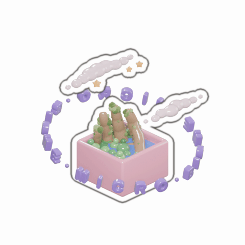

### Isaac Lombard

Full stack developer at [SSW](https://www.ssw.com.au/people/isaac-lombard), working where AI, design and engineering meet. 

I write about it at [iwrl.net](https://www.iwrl.net).

  <a href="https://www.iwrl.net">
    <picture>
      <source media="(prefers-color-scheme: dark)" srcset="./assets/microbiome-dark.gif">
      
    </picture>
  </a>

Currently shipping AI features and agentic workflows, and enterprise code. B.Eng (First Class Hons). 

Peaked when I ran an ~80km outback race at 18. 

He/him.
